<p align="center">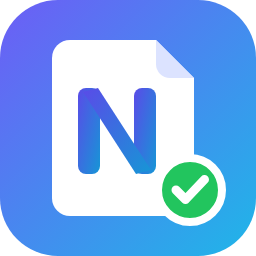</p>

# NoteSpace

**Your docs, notes, tasks and APIs — in one VS Code workspace, stored as plain files.**

NoteSpace is an MIT-licensed extension for VS Code and code-server that turns a folder into a personal or team workspace: a wiki with a visual Markdown editor, daily notes, tasks, Kanban boards and a calendar, Jupyter notebooks, charts and data dashboards, and an HTTP API client. Everything lives in readable files in your repository (Markdown, YAML, JSON), works offline, needs no account or server, and sends no telemetry.

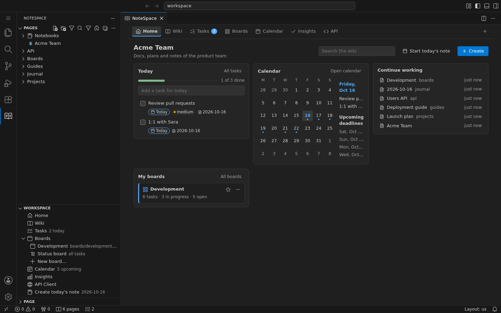

## Contents

- [Highlights](#highlights)
- [Tour](#tour)
- [Install](#install)
- [Getting started](#getting-started)
- [Your files](#your-files)
- [Privacy and security](#privacy-and-security)
- [Build from source](#build-from-source)
- [Documentation](#documentation)
- [Limitations](#limitations)
- [License](#license)

## Highlights

- **Home** — today's tasks with progress and quick add, a calendar preview with upcoming deadlines, recently edited pages, your boards and a single **Create** menu.
- **Wiki with a visual editor (Studio)** — edit Markdown visually with slash commands (`/`), a bubble menu, block handles, `[[wiki links]]`, callouts, tabs, steps, cards, tables, math, Mermaid diagrams and charts. Switch to **Code** (plain Markdown) or **Split** at any time; untouched lines stay byte-identical.
- **Tasks, Kanban and calendar** — tasks are ordinary `- [ ]` lines with `due:`, `priority:`, `status:`, `repeat:`, `#tags` and `@people`. Use them in lists and tables, on as many Kanban boards as you like (each board is a Markdown file with its own columns), and in a month/week/day calendar. Daily notes and recurring tasks included.
- **Kanban inside any page** — a ` ```tasks ` block with `view: board` shows a live board in the page; drag cards (or press Alt+←/→) and the task lines update.
- **Jupyter notebooks** — preview saved outputs without a kernel, embed notebooks in pages, run cells with your Python or the Jupyter extension, convert a notebook to a page.
- **API client** — requests with params, headers, bodies, auth (API key, Basic, Bearer, OAuth 2.0 with PKCE), tests and request chaining; collections as Git-friendly JSON; environments whose secrets stay in VS Code's secret storage; **paste a curl command** to fill everything in, and convert any request to **curl or Python `requests`**. Import OpenAPI files.
- **Interactive API docs** — ` ```http ` blocks in pages that readers send with one click (never automatically), with the response and test results under the request.
- **Charts and live data dashboards** — accessible charts from CSV/JSON, and dashboards computed from local Excel, CSV and JSON files with a safe formula language.
- **Reader and publishing** — a themed reader with search, outline and backlinks; export a static website, **PDF** or **EPUB**.
- **Knowledge tools** — content health report, advanced search (`tag:`, `path:`, `heading:`, …), link graph, page history from Git, translations, versions and review comments.

## Tour

### Home

Today's tasks, the calendar, what you were working on and your boards. Every destination (Home, Wiki, Tasks, Boards, Calendar, Insights, API) lives in one tab.


### Kanban boards

Each board is a Markdown file with its own columns, colors and a completed column. Drag cards, edit them inline, use swimlanes and saved order.

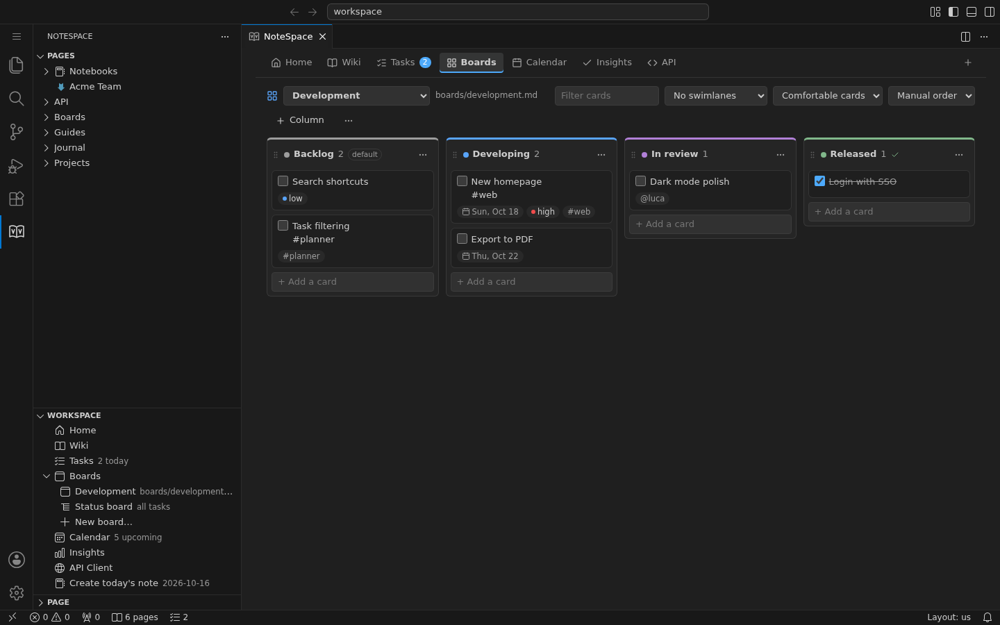

### Kanban inside a page

Put a live board of the page's tasks anywhere in your notes. Dragging a card rewrites only that task's line.

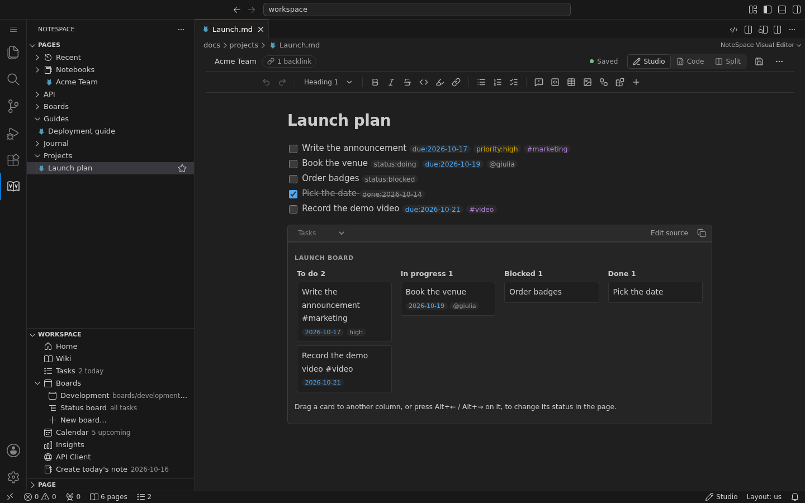

### Calendar

Month, week and day views over the same tasks. Drag a task to another day to change its due date; double-click a day to add one.

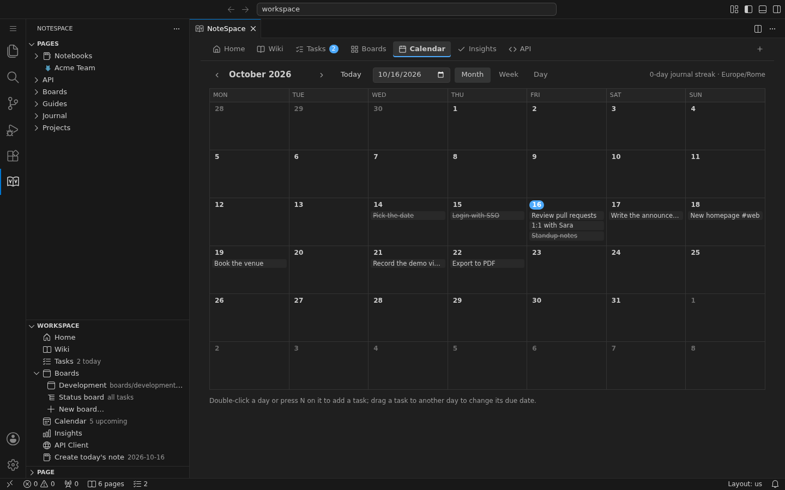

### Tasks

Today, Upcoming, Overdue, Inbox, All open and Completed lists, filters, grouping, saved views and a table layout.

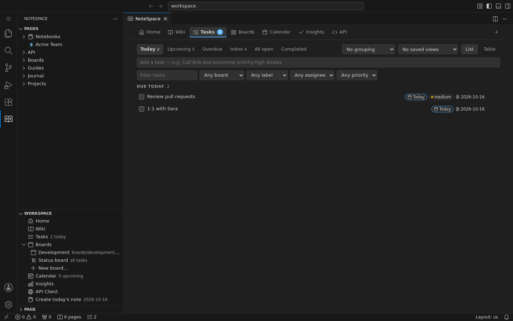

### Studio, the visual Markdown editor

Callouts, Mermaid diagrams, charts, tables and many more blocks — edited visually, saved as Markdown.

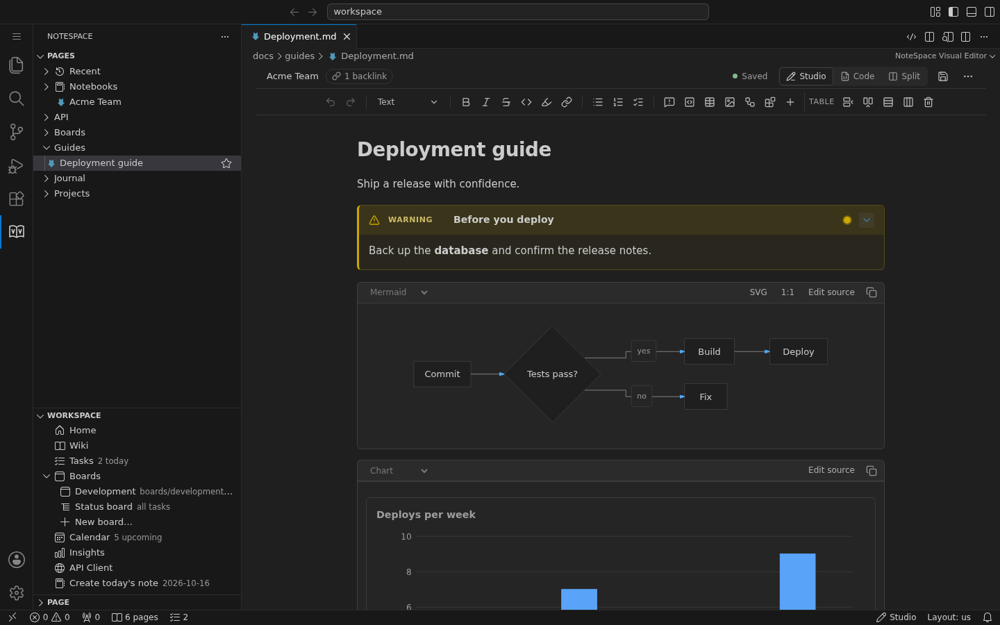

### Reader

A clean reading view with search, outline, backlinks and Focus Mode. The same renderer produces the static site, PDF and EPUB.

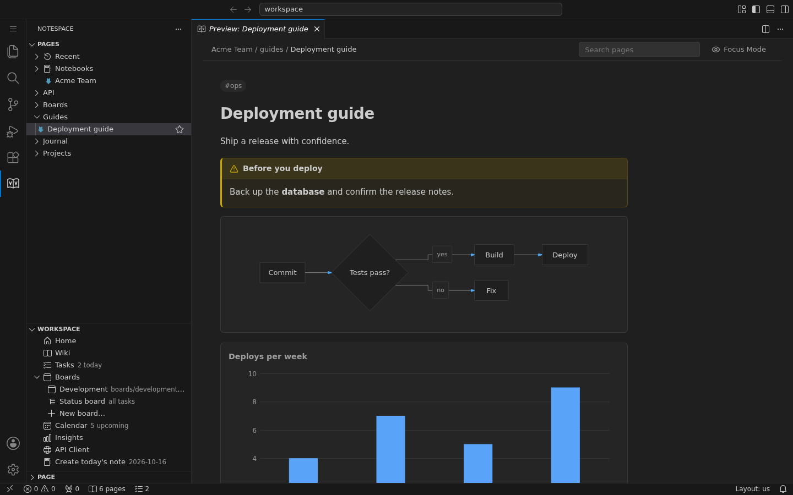

### Jupyter notebooks

Notebooks open in VS Code's notebook editor; NoteSpace adds a read-only preview of saved outputs (no kernel needed), notebook embeds in pages and a built-in Python kernel when the Jupyter extension is not installed.

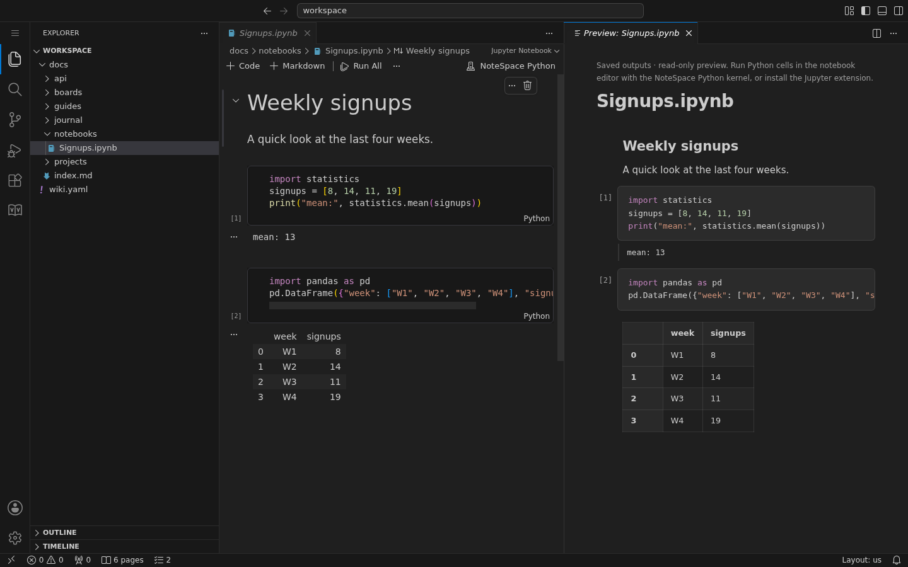

### API client

Collections, environments and history on the left; request tabs with params, auth, headers, body, cookies, tests and generated code; the response below. Paste a curl command and every field is filled in; the **Code** tab turns the request into curl or Python `requests` (with `params`, `headers` and `cookies` as dictionaries).

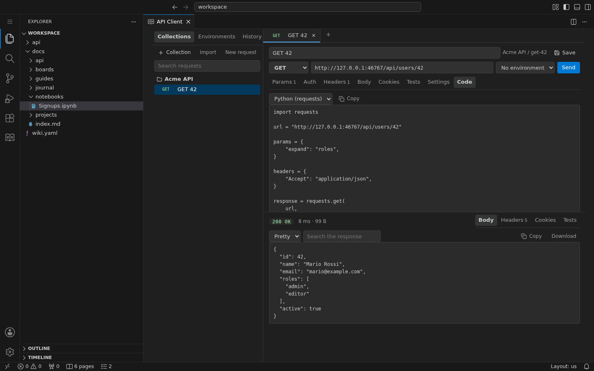

### Interactive HTTP blocks in docs

Document an endpoint once and let readers try it from the page. Nothing is sent until **Send** is pressed; the first request to each server asks for approval.

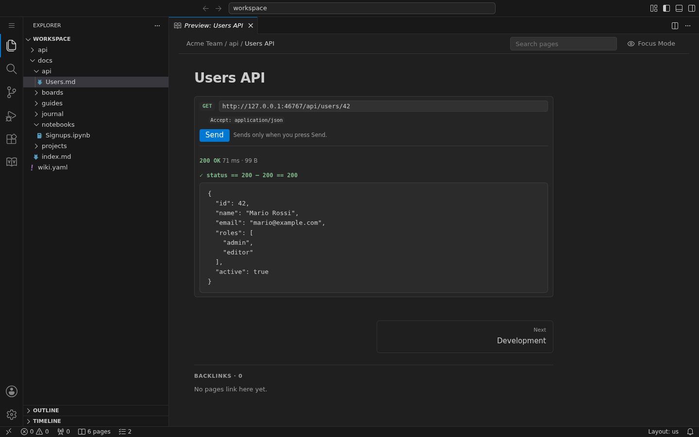

## Install

- **VS Code**: search for **NoteSpace** in the Extensions view, or run `code --install-extension hacknseek.notespace-workspace` ([Visual Studio Marketplace](https://marketplace.visualstudio.com/items?itemName=hacknseek.notespace-workspace)).
- **From a VSIX** (code-server, offline machines): download `notespace-workspace-<version>.vsix` from the [Releases](https://github.com/SeekNHack/NoteSpace/releases) page (built by GitHub Actions from the tagged source), then use Extensions view → **…** → **Install from VSIX…**, or `code-server --install-extension notespace-workspace-<version>.vsix`.

Reload the window afterwards. Requires VS Code 1.96 or later.

## Getting started

1. Open a folder and run **NoteSpace: Create Wiki** (or **Import Markdown or MkDocs Project** for existing docs).
2. Click the **NoteSpace** icon in the activity bar. **Pages** lists your pages; **Workspace** opens Home, Tasks, Boards, Calendar, Insights and the API Client.
3. Click a page to edit it in **Studio**; **Ctrl/Cmd+Alt+E** switches between Studio and Code.
4. Type `/` in Studio to insert blocks: callouts, tables, diagrams, charts, task boards, HTTP requests and more.
5. Add tasks anywhere: `- [ ] Call Bob due:tomorrow priority:high #sales`.

## Your files

| What                  | Where                                                                         |
| --------------------- | ----------------------------------------------------------------------------- |
| Wiki settings         | `wiki.yaml`                                                                   |
| Pages and daily notes | Markdown files (`.md`) in the docs folder                                     |
| Tasks                 | `- [ ]` lines in any page, with plain-text metadata                           |
| Boards                | Markdown files with a small front matter block (`boards/`)                    |
| API collections       | JSON files under `api/`, one per request; environments in `api/environments/` |
| Secrets               | VS Code SecretStorage only — never in files, exports or history               |

Nothing is stored in a database or in the cloud: commit the folder to Git and your whole workspace travels with it.

## Privacy and security

NoteSpace sends no telemetry and makes no network request on its own. Features that reach the network (the API client, HTTP blocks, optional AI and semantic search) act only when you ask, run only in trusted workspaces, always verify TLS certificates and keep credentials in VS Code's secret storage. Code runs only when you enable it and confirm. See [SECURITY.md](SECURITY.md).

## Build from source

Node.js 22.12+ and npm:

```sh
npm ci
npm test                              # typecheck + unit tests
xvfb-run -a npm run test:integration  # VS Code extension host tests (Linux without a display)
npm run package                       # builds notespace-workspace-<version>.vsix
npm run test:code-server              # browser journeys on code-server (requires code-server and Chromium)
```

More browser journeys: `test:workspace`, `test:planner`, `test:api`, `test:embedded-board`, `test:rich`, `test:phase04`–`test:phase08`. See [docs/testing.md](docs/testing.md) and [docs/development.md](docs/development.md). `node scripts/readme-screenshots.mjs` regenerates the images in this README.

## Documentation

- [Planner, tasks, boards and calendar](docs/planner.md)
- [API client and HTTP blocks](docs/api-client.md)
- [Markdown support](docs/markdown-support.md) and [editor design](docs/editor-design.md)
- [Charts, notebooks, canvases and OpenAPI](docs/visualization.md)
- [Data dashboards](docs/dashboards.md)
- [Knowledge tools](docs/knowledge.md)
- [Wiki format](docs/wiki-format.md) and [static export](docs/static-export.md)
- [Architecture](docs/architecture.md) and [security](SECURITY.md)
- [Changelog](CHANGELOG.md)

## Limitations

- Pages with constructs Studio cannot round-trip exactly (for example links inside formatted text, or nesting deeper than four levels) open in Code.
- OAuth 2.0 in the API client supports client credentials and authorization code with PKCE; implicit, password and device flows, token refresh and client certificates are not supported. No proxy support or collection import from other API tools yet.
- The Python kernel and code runner need Python or Node installed locally and are off until you enable them.
- Settings from builds made before the rename (`wikiStudio.*`) are not migrated automatically; boards, collections and review files are.

## License

[MIT](LICENSE). Third-party licenses are listed in [THIRD_PARTY_NOTICES.md](THIRD_PARTY_NOTICES.md).
