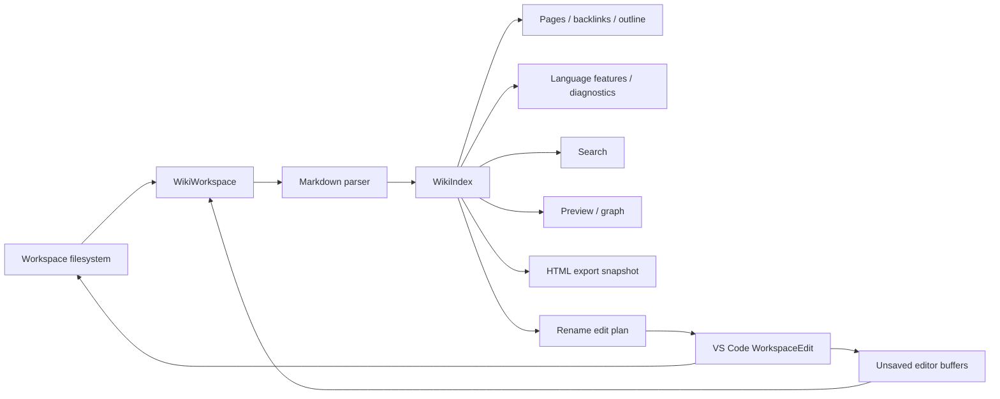

# Architecture and product contract

The starting workspace was empty and no product specification was supplied. The implemented product is a local-first Markdown wiki in VS Code, with the scope and boundaries documented in README. It is not a MediaWiki/Wikipedia client or a hosted collaboration service.

## Data flow

`core/` is independent of VS Code. Pages carry UTF-16 source offsets, normalized relative paths, URI strings, metadata, headings and links. Parser offsets are used for navigation, diagnostics and targeted refactors. The shared resolver isolates workspace roots and defines ambiguity, relative paths and heading semantics. Title/filename aliases and URI lookups are indexed for constant-time candidate access.

`WikiWorkspace` discovers configured roots, performs bounded concurrent reads, reports partial-index issues, and overlays editor buffers on disk snapshots. Filesystem/configuration changes trigger debounced serialized refreshes; in-memory edits update the index immediately. Refreshes never publish a stale concurrent scan. Skipped pages remain visible as status/output warnings. Runtime state is disposable and no database or cache migration is needed.

`views.ts` implements native trees and language providers. Diagnostics are debounced. Commands validate inputs and surface failures through notifications plus a dedicated output channel. All page writes use workspace filesystem/URI APIs. Create, rename and trash/restore are VS Code workspace edits. Portable trash avoids dependence on desktop recycle-bin APIs in code-server. Renames preserve title/body text and leave updated link buffers available for save and undo.

`webviews.ts` supplies two presentation-only panels. The only accepted messages are navigation to an indexed page and user-initiated HTTP(S)/mailto links. It does not expose filesystem writes or arbitrary commands. The renderer supplies a single set of heading and link rules to preview and export. Export clones the page collection and writes into a fresh directory; its failure path removes only that directory.

## Reliability boundaries

- Links are scoped to one wiki; cross-root links are not rewritten.
- External file renames are observed but do not trigger implicit edits to other files.
- Link refactoring is scoped to indexed links; unsupported Markdown source forms are documented in README.
- File providers may have partial/no write or watcher support; failures are surfaced, not treated as success.
- The index is intentionally rebuilt for disk changes. Text edits update individual pages. This favors understandable consistency over a persistent database.
- The graph caps drawn nodes at 150; search returns 200 ranked results; index and file-size limits are configurable.
- The extension depends on VS Code for undo, persistence prompts, filesystem provider semantics and version control.

## Source guide

| Path                                  | Responsibility                                           |
| ------------------------------------- | -------------------------------------------------------- |
| `src/core/markdown.ts`                | Metadata, headings, source ranges and wiki token parsing |
| `src/core/index.ts`                   | Resolution, search, backlinks, graph and rename plans    |
| `src/core/render.ts`                  | Safe shared rendering and export shell                   |
| `src/workspace.ts`                    | Discovery, watchers, editor overlays and page writes     |
| `src/views.ts`                        | Native UI and language providers                         |
| `src/webviews.ts`, `media/webview.js` | Live preview, graph and validated navigation             |
| `src/export.ts`                       | Snapshot export, asset copying and cancellation cleanup  |
| `src/extension.ts`                    | Activation, command workflows, status and disposal       |

## API references

Implementation follows the official [VS Code webview guidance](https://code.visualstudio.com/api/extension-guides/webview), [extension-host testing guide](https://code.visualstudio.com/api/working-with-extensions/testing-extension), and [workspace trust guide](https://code.visualstudio.com/api/extension-guides/workspace-trust). UI automation attaches to the test instance via [Playwright's Chromium CDP support](https://playwright.dev/docs/api/class-browsertype#browser-type-connect-over-cdp).
