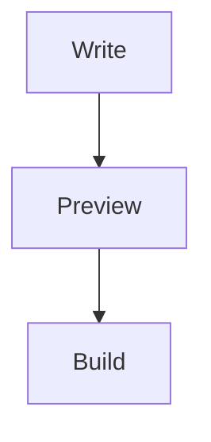

# NoteSpace Example

Write documentation in the Markdown editor or open the visual editor. Browse the [getting-started guide](guides/getting-started.md).

:::note
All content is stored as local files. No account or server is needed.
:::

